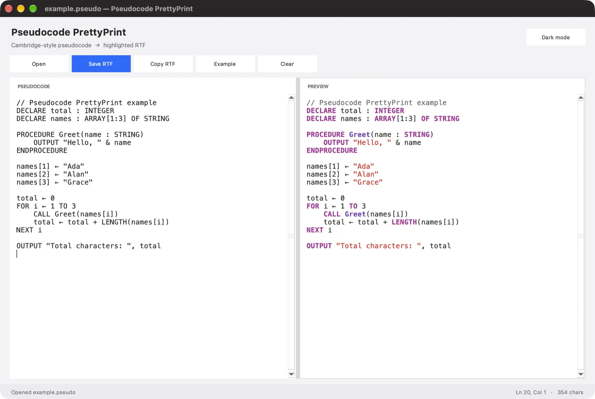
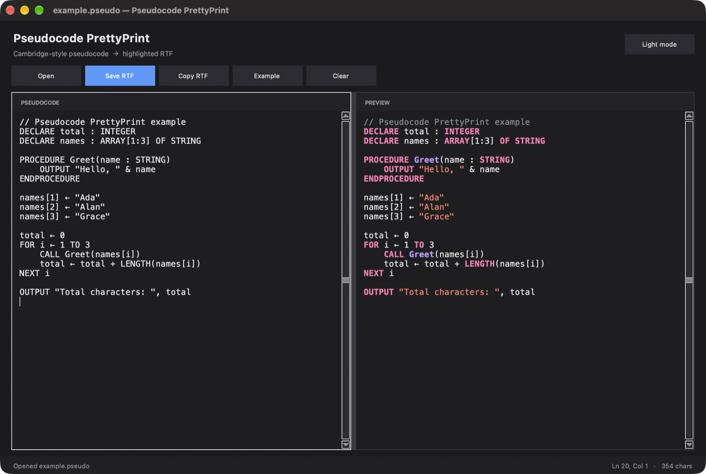

# Pseudocode PrettyPrint

Convert Cambridge-style pseudocode into syntax-highlighted RTF. Ships with a
native desktop app for macOS and Windows, plus a scriptable command-line
interface.

The pseudocode format follows the Cambridge International syllabus; see the
[full guide](https://www.cambridgeinternational.org/Images/697401-2026-pseudocode-guide-for-teachers.pdf).
The colour scheme is based on Xcode's light-mode pretty-print style. Apple's
design guidelines are available
[here](https://developer.apple.com/design/human-interface-guidelines/color).

## Download the desktop app

Open the [Releases](https://github.com/james8464/Pseudocode-PrettyPrint/releases)
page and download the build for your computer:

| Platform | File |
|----------|------|
| macOS, Apple silicon | `PseudocodePrettyPrint-macOS-arm64.dmg` |
| macOS, Intel | `PseudocodePrettyPrint-macOS-x86_64.dmg` |
| Windows 10/11, 64-bit | `PseudocodePrettyPrint-Windows-x64.zip` |

On macOS, open the `.dmg` and drag the app into Applications. On Windows,
unzip the archive and run `PseudocodePrettyPrint.exe`.

The builds are not code-signed. On first launch:

- **macOS:** right-click the app and choose **Open**, then confirm.
- **Windows:** if SmartScreen appears, choose **More info → Run anyway**.

You only need to do this once per download.

## Desktop app



The window gives you a pseudocode editor and a live syntax-highlighted preview
side by side.

<details>
<summary>Dark appearance</summary>



</details>

- Live preview as you type, with the same rules as the RTF export.
- Light and dark appearances.
- Open and save UTF-8 pseudocode files, including recent-file shortcuts.
- Export RTF, or copy the RTF markup to the clipboard.
- Find text, adjust the font size, and toggle word wrap.
- Remembers your theme, text size, window position, and recent files.
- Clear error messages for unterminated strings and unsupported characters.

### Keyboard shortcuts

| Action | macOS | Windows |
|--------|-------|---------|
| Open | Cmd+O | Ctrl+O |
| Save pseudocode | Cmd+S | Ctrl+S |
| Save pseudocode as | Cmd+Shift+S | Ctrl+Shift+S |
| Export RTF | Cmd+E | Ctrl+E |
| Copy RTF | Cmd+Shift+C | Ctrl+Shift+C |
| Find | Cmd+F | Ctrl+F |
| Larger / smaller text | Cmd+plus / Cmd+minus | Ctrl+plus / Ctrl+minus |
| Reset text size | Cmd+0 | Ctrl+0 |
| Refresh preview | F5 | F5 |
| Syntax guide | F1 | F1 |
| Quit | Cmd+Q | Ctrl+Q |

Settings are stored in the platform's usual per-user location:

- macOS: `~/Library/Application Support/PseudocodePrettyPrint/settings.json`
- Windows: `%APPDATA%\PseudocodePrettyPrint\settings.json`
- Linux: `~/.config/PseudocodePrettyPrint/settings.json`

## Run from source

Python 3.10 or newer is required, with Tkinter available. There are no runtime
dependencies outside the standard library.

```bash
python3 -m pip install -e .
pseudocode-prettyprint-gui
```

You can also launch the app without installing:

```bash
python3 -m pseudocode_prettyprint.gui
python3 main.py --gui
```

If your Python was installed with Homebrew and Tkinter is missing, install it
with `brew install python-tk@3.13` (matching your Python version). The
python.org installers for macOS and Windows include Tkinter.

## Command line

```bash
python3 main.py < input.txt
python3 main.py input.txt
python3 main.py input.txt --stdout
python3 main.py input.txt -o report.rtf
pseudocode-prettyprint input.txt --force
```

| Option | Meaning |
|--------|---------|
| `input` | Input file; omit it to read from stdin |
| `-o`, `--output PATH` | Output file, or an output directory |
| `--stdout` | Write the RTF document to standard output |
| `--force` | Overwrite an existing output file |
| `--gui [input]` | Open the desktop app, optionally with a file |
| `--version` | Print the version |

By default, documents are written to `./outputs`. Existing files are never
overwritten: the next free numbered name is used
(`pretty_pseudocode.rtf`, `pretty_pseudocode_2.rtf`, ...). Use `--force` to
overwrite deliberately, or `--stdout` to write the RTF to standard output.
Input files must be UTF-8. Output is written atomically, and warnings are
printed to standard error.

## Customising colours

Colours are defined in `pseudocode_prettyprint/constants.py` in the `COLOURS`
dictionary. Each entry is a `(red, green, blue)` tuple of integers in the range
0-255. The RTF colour table and `\cfN` mapping are generated from this
dictionary, so editing a value there is sufficient. The desktop app's light
appearance uses the same palette; its dark palette lives in
`pseudocode_prettyprint/gui.py`.

## Supported syntax

### Keywords and built-ins

```text
AND, APPEND, ARRAY, ASC, BOOLEAN, BYREF, BYVAL, CALL, CASE, CHAR, CHR,
CLASS, CLOSEFILE, CONSTANT, DATE, DECLARE, DIV, ELSE, ENDCASE, ENDCLASS,
ENDFUNCTION, ENDIF, ENDPROCEDURE, ENDTYPE, ENDWHILE, EOF, FALSE, FOR,
FUNCTION, GETRECORD, IF, INHERITS, IMPORT, INPUT, INT, INTEGER, IS_NUM,
LCASE, LEFT, LENGTH, MID, MOD, NEW, NEXT, NOT, NUM_TO_STR, OPENFILE, OF,
OR, OTHERWISE, OUTPUT, PRINT, PROCEDURE, PRIVATE, PUBLIC, PUTRECORD,
RAND, READ, READFILE, REAL, REPEAT, RETURN, RETURNS, RIGHT, SEEK, STEP,
STRING, STR_TO_NUM, SUPER, THEN, TO, TRUE, TYPE, UCASE, UNTIL, WHILE,
WRITE, WRITEFILE
```

`END` is reserved as the interactive end-of-block marker and is not a
language keyword.

### Assignment

```pseudo
x ← 5
name ← "alice"
count ← count + 1
```

### Comments

Single-line comments use `//`:

```pseudo
// this is a comment
```

### Strings

Strings are delimited by double quotes. Straight and curly double quotes are
accepted:

```pseudo
PRINT "hello world"
message ← "enter your name: "
```

### Types

```pseudo
DECLARE x : INTEGER
DECLARE name : STRING
DECLARE is_valid : BOOLEAN
DECLARE price : REAL
DECLARE ch : CHAR
DECLARE today : DATE
```

### Operators

- arithmetic: `+`, `-`, `*`, `/`, `DIV`, `MOD`
- comparison: `=`, `<>`, `<`, `>`, `<=`, `>=`
- logical: `AND`, `OR`, `NOT`

### Syntax highlighting

| Element | Colour |
|---------|--------|
| keywords | bold purple |
| strings | red |
| calls / procedures | bold purple |
| members (after `.`) | blue |
| indices (after `.`) | dark blue |
| comments | grey |

Procedure, function, class and type names are found from declarations and from
`CALL`, `NEW` and `INHERITS`, rather than from capitalisation. Tabs are
rendered as RTF tab stops; non-BMP Unicode is encoded as surrogate pairs.
Unrecognised characters and malformed input produce diagnostics instead of
silently corrupting the output.

## Example

Input:

```pseudo
// calculate factorial
DECLARE n : INTEGER
DECLARE result : INTEGER

INPUT n
result ← 1
FOR i ← 1 TO n
    result ← result * i
NEXT i

OUTPUT result
```

## Development

Run the regression suite with either:

```bash
python3 -m unittest discover -s tests -v
# or
pytest
```

Lint, type-check and test:

```bash
python3 -m pip install -e ".[dev]"
ruff check .
mypy pseudocode_prettyprint
pytest
```

GUI tests that need a display are skipped automatically when no display is
available, so the suite still runs on headless CI.

## Building desktop apps

The release workflow builds macOS and Windows bundles when a `v*` tag is
pushed:

```bash
git tag v1.2.0
git push origin v1.2.0
```

To build locally, install PyInstaller and run the command for your platform:

```bash
python3 -m pip install -e ".[build]"

# macOS
pyinstaller --noconfirm --clean --windowed \
  --name "Pseudocode PrettyPrint" \
  --osx-bundle-identifier com.james8464.pseudocodeprettyprint \
  --icon packaging/icons/app.icns \
  --paths . \
  packaging/gui_entry.py

# Windows
python packaging/make_version_info.py build/version_info.txt
pyinstaller --noconfirm --clean --onefile --windowed \
  --name PseudocodePrettyPrint \
  --icon packaging/icons/app.ico \
  --version-file build/version_info.txt \
  --paths . packaging/gui_entry.py
```

The committed icon files are generated from `packaging/make_icon.swift`; on macOS,
`./packaging/build_icons.sh` regenerates both the `.icns` and `.ico`.

## Licence

MIT. See [LICENSE](LICENSE).
